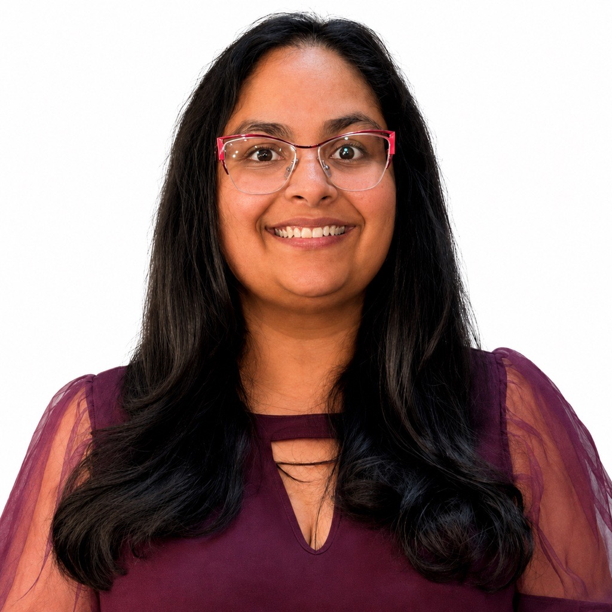

# Jetshri's Academic Portfolio

A home for my academic work, projects, and experiences.

## Contents

- [About](#about)
- [Academic Interests](#academic-interests)
- [Publications](#publications)
- [Contact](#contact)
- [Social Media](#social-media)

## About

Jetshri Bhadviya is a curator, educator, designer, and new media artist whose work explores the relationship between the human body, space, and its emotional, cultural, and metaphysical dimensions through video, sound, performance, and photography. Her creative practice investigates surreal and unstructured bodily states, often examining how bodies are perceived and contextualized within physical environments.

She is an Assistant Professor in the School of Digital Media Production at Daytona State College. She is also pursuing a PhD in Texts and Technology, specializing in Digital Media, at the University of Central Florida. She holds an MFA in Photography from Cranbrook Academy of Art and a BFA in Studio Arts from the American University in Dubai. Since 2015, she has taught at the College for Creative Studies and Oakland University in Michigan.

As a Curatorial Assistant at the Detroit Institute of Arts, Jetshri supported exhibitions exploring themes of identity, migration, environment, and representation, with a strong emphasis on inclusion and highlighting underrepresented artistic voices. She also served as the Arts and Culture Commissioner for Hamtramck, Michigan.

Jetshri's exhibitions have been featured at institutions including the Grand Rapids Art Museum, Kresge Arts Foundation, and David Klein Gallery in Michigan, as well as internationally at Dubai's Sheikha Manal Young Artist Foundation, where she was recognized as a top-ten artist in 2011. She received the prestigious Toby Dewan Lewis Fellowship Award in 2015, honoring outstanding MFA graduates across the United States.

### Art Practice and Research Interests

As an artist, I explore the layered complexities of personal identity, cultural heritage, and the human experience through photography, performance, sound, and sculpture. My practice is deeply influenced by my upbringing in Jainism, an ancient Indian tradition centered on non-violence, introspection, and spiritual growth. In parallel, my early training in Kathak, a classical Indian dance form, fostered a deep appreciation for rhythm, storytelling, and discipline. These formative influences continue to shape my exploration of the dynamic balance between tradition and personal expression.

While the principles of restraint and detachment inform my philosophical lens, my artistic work reaches beyond these foundations to investigate how social frameworks shape and sometimes limit our sense of self. Through performance and its photographic traces, I build spaces where conventional identity markers can be momentarily suspended. Whether wrapped in ropes adorned with bells—evocative of cultural expectations—or veiled in translucent fabric forms, my body becomes a medium for inquiry and transformation.

The photographs I create are more than documentation; they hold a tension between presence and disappearance. By partially obscuring the figure, I invite the viewer to reconsider the ways we interpret identity—through appearance, origin, and biography—while opening a space for ambiguity and becoming.

Sound is an equally vital element in my work, building immersive sonic environments that mirror and expand the visual. In *#CheckYourMisconceptionsAtTheDoor*, for example, I emerge from a shapeless form as an anonymous voice asks:

> Can you see me?  
> Why do you think I'm here?  
> I am unwilling to disclose my identity.  
> I'm no one.  
> I'm not from here.  
> I'm not from anywhere.

This becomes both a personal statement and an open prompt, inviting the audience to reflect on perception and presence. In an increasingly categorized world, I offer a space for fluidity—where the undefined self can be both powerful and poetic.

### Community Statement

I am dedicated to cultivating inclusive and engaging spaces that support diverse creative voices and encourage meaningful cultural dialogue. Through my work as a curator, educator, and artist, I aim to build platforms where individuals from a variety of backgrounds can share their stories, ideas, and artistic visions. Whether through exhibitions, performances, or collaborative initiatives, I focus on creating opportunities for thoughtful engagement around themes of identity, visibility, and cultural exchange. My goal is to foster understanding and collaboration within the arts and beyond, encouraging open dialogue and shared learning. Through this work, I hope to support a more connected and responsive artistic community.

### The Educator in Me

With over a decade of teaching experience, I guide students in lens-based media by integrating technical instruction with conceptual development. My approach is responsive to the needs of individual learners, emphasizing creative experimentation and critical inquiry. Beyond the classroom, I connect students with real-world opportunities—exhibitions, internships, and collaborations—that help them grow as artists and cultural contributors. My teaching encourages curiosity, resilience, and a sense of purpose, empowering students to shape and participate in the evolving landscape of contemporary media and visual storytelling.

### The Curator in Me

As a curator, I strive to create thoughtful and welcoming spaces that reflect a wide range of artistic perspectives and lived experiences. I believe in the power of art to inspire reflection, spark dialogue, and deepen our understanding of the world around us. Through the exhibitions and projects I have curated, I aim to support creative expression, foster meaningful engagement, and encourage conversations that extend beyond the gallery space.

## Academic Interests

My academic and research interests lie at the intersection of photography, digital media, visual culture, critical making, and interdisciplinary artistic research. Through practice-based inquiry, I explore how identity, memory, displacement, cultural narratives, and embodied experiences are constructed, represented, and transformed through artistic practices and emerging technologies. My research examines the body and objects as archives of personal and collective memory, particularly in relation to diaspora, gender, spirituality, mythology, and cultural inheritance. I am also interested in the intersections of technology, authorship, ethics, and representation, investigating how artificial intelligence, digital archives, surveillance, and immersive media shape our understanding of identity and lived experience. As an artist, curator, and educator, I approach creative practice as a form of knowledge production, using material experimentation, critical inquiry, and interdisciplinary methodologies to challenge dominant narratives and explore alternative ways of knowing.

**Areas of Academic Interest:**

- Practice-Based Research, Research-Creation, and Critical Making
- Photography, Visual Culture, and Alternative Photographic Processes
- Identity, Cultural Memory, Diaspora, and Displacement
- Feminist Theory, Postcolonial Studies, and Body Politics
- Digital Humanities, Artificial Intelligence, and Emerging Media
- Material Culture, Ritual, Mythology, and Object-Based Inquiry
- Authorship, Representation, Surveillance, and Technology Ethics
- Curatorial Studies, Exhibition-Making, and Audience Engagement
- Environmental Humanities, the Anthropocene, and Ecological Justice
- Interdisciplinary Art and Design Pedagogy

## Publications

Add publications, presentations, or other scholarly work. If you have none yet, you can remove this section.

## Contact

Add your preferred email address or other contact information.

## Social Media

Add links to your professional profiles, such as LinkedIn, GitHub, or Google Scholar.
